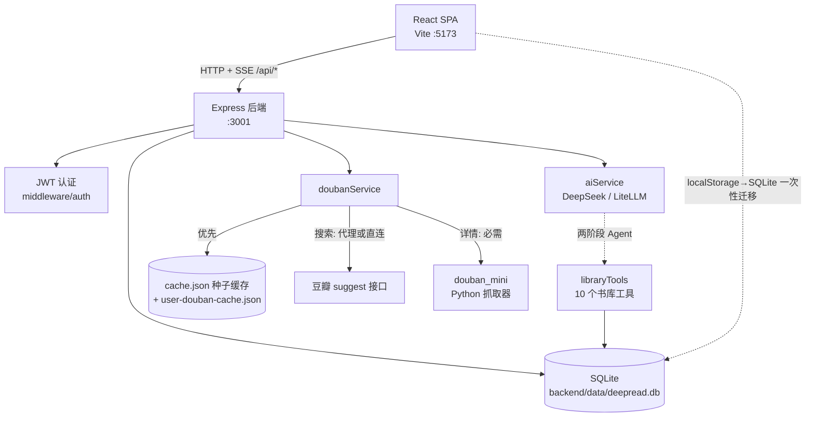

# 系统架构全景（Architecture Overview）

本文只记录"看代码看不出来"的内容：系统全景、模块边界、关键数据链路与已知取舍。函数级细节请直接读源码。

> 想要一张跟着流程走的图（一次请求的 9 步、提示词逐段成本、闸门、能力边界、未接线的端点）：打开 [`docs/agent-map.html`](docs/agent-map.html)。
> 想随时自查"这次请求往模型里塞了什么"：`cd backend && node inspect-context.js`（零 token，与线上共用 `buildAdvisorPrompt()`）。

## 1. 系统全景



前后端完全分离：前端是纯静态 SPA（可部署到 Netlify，见 `netlify.toml`），后端是独立 Node 进程，通过 `VITE_API_BASE`（默认 `http://localhost:3001/api`）连接。

## 2. 模块划分与依赖边界

| 模块 | 职责 | 依赖规则 |
|------|------|---------|
| `App.tsx` + `components/` | 视图渲染与交互 | 只能通过 `services/` 调后端，禁止直接 fetch 其他地址或写数据库 |
| `services/`（前端） | API 客户端 + Token 管理 | Token 存 localStorage，每次请求带 `Authorization` 头；`API_BASE` 只在 `authService.ts` 定义并导出，其余模块从它导入。两个客户端按域分工：`geminiService.ts`（历史命名，实为 `/api/ai/*` + SSE 解析）管 AI，`librarianService.ts` 管批量入库与分类元数据（`/api/books/batch`、`/api/books/auto-categorize`、`/api/profile/category-meta`），`useBookLibrary` 直接依赖后者 |
| `hooks/` | 流式请求、防抖、打字机 | 纯逻辑复用层，可调 `services/` |
| `backend/src/routes/` | HTTP 端点 | books / profile / ai 三个路由挂载时统一 `router.use(requireAuth)`；`douban` 的 `/cover` 例外（`` 带不了 Authorization，见 §3 封面获取），其余 douban 端点仍需鉴权；免鉴权的只有 `/api/auth/register`、`/api/auth/login`、`/api/health`、`/api/douban/cover` |
| `backend/src/services/` | 业务逻辑 | `aiService`（AI 调用 + Agent 循环）、`doubanService`（豆瓣数据源）、`libraryTools`（Agent 的 12 个书库/记忆工具 + 常驻书库概览 + 长期记忆检索注入）、`recommendValidation`（推荐输出回传前的 bookId 清洗与站外去重）、`libraryStats`（统计口径唯一实现） |
| `backend/src/prompts/` | 提示词模板 | 与 AI 功能一一对应，与路由代码分离 |
| `backend/src/db/database.ts` | SQLite 建表与访问 | 所有表结构集中于此，`CREATE TABLE IF NOT EXISTS`；`BookRow` / `rowToBook` / `bookToParams` / `loadUserLibrary` 等行级读写辅助也在这里，`books` 路由与 Agent 工具共用同一份，不再各写一套。画像同理：`loadUserProfile` / `updateUserProfileInDb` 被 `GET/PUT /api/profile` 与 Agent 的 `update_user_profile` 共用；`addRecommendationFeedback` / `listRecommendationFeedback` 是推荐采纳反馈的唯一读写口 |

注意：`services/geminiService.ts` 是历史命名，它现在调用的是后端 `/api/ai/*` 端点，与 Gemini 无关。

**请求校验的真实现状**（三种写法并存，勿假设统一门槛存在）：`ai.ts` 用 `validate(schema)` 中间件——注意它是 `routes/ai.ts` 内的局部函数，未导出，其他路由文件 import 不到；`auth.ts` / `books.ts` 在处理器内直接 `schema.parse(req.body)`；`douban.ts` 的 search / batch / cover / find 端点直接解构 `req.query` / `req.body`，未过 Zod。新增写接口应带 schema，沿用所在文件的既有写法即可，不要为此重构范围外路由。唯一的例外是 `components/IngestionWizard.tsx:60` 内联了一份 `VITE_API_BASE`（拼封面代理 URL），改默认后端地址时容易被漏掉。

## 3. 关键数据流向

**登录认证**：`LoginPage` → `POST /api/auth/login` → 后端 bcrypt 校验 + 签发 JWT → 前端存 localStorage → 后续所有请求带 `Authorization: Bearer`。

**书库同步**：`App.tsx` 的 `useBookLibrary` 是书库唯一数据源。挂载时 `GET /api/books` 加载；保存走 `POST /api/books/batch` 全量同步（防抖）。首次登录且后端书库为空时，自动执行一次 localStorage → SQLite 迁移（标记键 `deepread_migrated_to_db`）。

**书籍导入**：`IngestionWizard` → `GET /api/douban/search` 搜豆瓣候选 → 用户选定版本（不自动选）→ `POST /api/ai/classify` AI 补全分类/难度 → 批量保存。

**豆瓣数据补全（导入失败后的补救）**：`POST /api/books/:id/refresh-douban` → `refetchBookDetail(doubanId, title)`（`doubanService`）→ 有 ID 直抓详情，没 ID 或失败则按书名搜、**逐级放宽查询串**（`titleQueryVariants`：原名 → 去括号 → 截掉副标题）。合并时只填补空白：`doubanData` 用 `doubanDataScore` 比较，新数据更完整才整体替换；`author`/`publisher`/`doubanId`/`coverUrl`/`isbn` 仅在原值为空时填入；`title`/`category`/`level`/`userData`/`aiInsight` 一律不动。**这套策略的由来**：书籍导入时抓取可能失败（Python 缺失、超时、限流），失败的书在库里就是"只有书名"，以前只能删掉重加——而那样会连阅读进度、AI 解读、自评星级一起丢掉。

**AI 流式调用（Agent 两阶段）**：`POST /api/ai/*/stream` → 路由先 `createAgentContext(req.user!.id)` 从 SQLite 载入该用户的书库与画像 → `aiService.callAgentStream({ systemPrompt, userPrompt, ctx, handlers, ... })`（原先 13 个位置参数已收敛成这一个 options 对象）：
1. **思考阶段**（静默、非流式）：多轮工具调用循环，模型通过 `libraryTools` 查询书库与记忆（`search_library`、`get_book_details`、`get_reading_taste_profile`、`update_book_status`、`update_user_profile`、`remember`、`recall_memory` 等 12 个工具；配了 Exa 再 +2 个联网工具），最多 4 轮（`MAX_ROUNDS` 硬编码在 `callAgentStream` 内）后截断。**4 而不是 3**：101 本以上概览不再注入完整书名，模型必须先查工具才能给出真实 bookId，实测 413 本库上"从书架挑三本"恰好用满 3 轮——第 3 轮既是查询轮又是收敛轮，再触发硬闸门就没有余量了。推荐端点额外带 `requireLibraryTool`：模型声称给出了 `libraryMatches` 却一次书目工具都没调，就追加一条纠正消息补 1 轮强制查证（上限 1 轮，不影响其它端点）；
2. **表达阶段**（流式）：基于工具收集的上下文，SSE 推送给用户。

SSE 语义事件协议（前端 `services/geminiService.ts` 解析）：
```
{ type: 'phase' | 'tool_call' | 'chunk' | 'reasoning' | 'book_update' | 'done' | 'error' }
```
所有流式端点在 compression 中间件中被跳过（见 `backend/src/index.ts` 的 filter），新增 `/stream` 端点天然继承此行为。

**Agent 的数据来源契约**（改错了不报错，只会变"哑"或丢数据）：
- **书库与画像只有一个真源**：流式端点跑的是带工具的 Agent，能读能写，所以它们的书库/画像一律由后端从 SQLite 载入（`createAgentContext(userId)`），请求体里**不再传 `library` / `userProfile`**，客户端传了也不作数。这样 Agent 看到的和用户界面上的是同一份数据。仍然走请求体的只有"用户在界面上勾选的那批书"（`reading-path` 的 `books`、classify / reorganize 的 `titles`）——那是请求参数，不是书库。
- **AI 写库直接落 SQLite，`book_update` 是反向通知**：`update_book_status` 立刻按 `user_id` 分区 `UPDATE`，并清空本次请求的工具缓存，让后续工具读到新值。`book_update` 事件的作用不再是"让前端去写库"，而是"告知客户端它那份内存副本已过期"——`App.tsx` 监听 `aiBookUpdate` 把改动 patch 回 `useBookLibrary`。**漏接不会丢 AI 的写入，但客户端下一次防抖全量保存会把它冲掉**，所以 `routes/ai.ts` 的 `sseHandlers()` 对全部流式端点一律接上 `onBookUpdate`，不做取舍。
- **非流式端点仍可自带书库**：`/classify`、`/recommend` 等只走 `callAI`、不带工具循环、改不了库，客户端传来的 `library` 在那里是无害的请求数据，未纳入上述契约。
- **推荐结果在回传前对齐真实书库**：`recommendValidation.validateAdvisorJson` 逐条核对 `libraryMatches` 的 `bookId`，对不上就用模型同时给出的 `title` 反查修复，修不掉才丢弃，并把 `kept / repaired / dropped / droppedTitles` 塞进响应的 `matchValidation`。这一步有效的前提是**客户端渲染的是 `done` 里那份返回值而不是 chunk 原文**；提示词因此强制要求每条 `libraryMatches` 带 `title`，少这个字段就无从自愈。`externalMatches` 是站外新书、天然没有 bookId，不清洗。
- **长期记忆与画像分工写死，不许互相回写**：`user_memories` 存**没有槽位**的事实／偏好／禁忌／约定（"我在准备考试""我不看成功学"）；`user_profiles` 存有槽位的稳定属性。记忆**不得**写进画像字段（否则来源保护被绕过），能从书库查到的（藏书量、分类）也不该记。
  - 写入两条路：`remember` 工具（用户明确要求或陈述 → `source='user'`）与回合后抽取（用户没要求过的后台写入 → 一律 `source='ai'`）。两者都必须带 `evidence`（用户原话）；同内容去重；**被用户删过的内容永不复活**（`status='rejected'` 是墓碑，同时挡住同内容再次写入）。
  - 读取是**检索式注入，不是全量**：`selectRelevantMemories` 用二元字组重叠打分（中文没有空格）。`constraint` 有意加权——踩到用户明说过的禁忌，代价高于漏掉一条偏好，所以它即使与当前问题字面无关也会被带上，但**限流 2 条**以留槽位给真正相关的内容。硬上限：≤3 条、内容合计 <500 字符（实测 155 字符）。`recall_memory` 工具让模型主动查更多。
  - 为什么必须限流：画像 4 个字段 160 字符可以无脑全发，记忆会长到几百条；全量注入会稀释指令——"370 行提示词里第 35 行那句话被稀释到 0 次触发"是这个仓库付过学费的教训。活跃上限 `MAX_ACTIVE_MEMORIES = 200`，到顶拒绝新增并让模型去合并。
- **画像写入只有一个函数**：`updateUserProfileInDb` 只写 `!== undefined` 的字段，REST `PUT /api/profile` 与 Agent 的 `update_user_profile` 共用它，所以调用方必须只发自己要改的字段。整份旧快照 PUT 回去会把 AI 刚写进去的字段按旧值冲掉——设置页表单因此改成"只发自己拥有的 4 个字段 + 进页时重新 `fetchProfile`"。
- **画像字段带来源，AI 的推测不得覆盖用户的期望**（`profile_field_meta` 表，逐字段一行；加新表不受"无迁移系统"限制）：
  - `source: 'user'` —— 用户在设置页填的（`via: 'form'`）或用户在对话里明确说的（`via: 'conversation'`，`evidence` 存原话片段）。**这是用户的期望：可能不够细、不够准，但它是权威**。`updateUserProfileInDb` 在 `source: 'ai'` 时对这些字段一律拒绝，命中的进 `refused` 原样回给模型，让它如实说"这条是你自己定的，我改不了"，而不是静默失败或反复重写。
  - `source: 'ai'` —— AI 从对话里记录/推断的，只能填空白字段或改自己之前写的字段，且 `evidence`（用户原话）必填，会随字段一起展示给用户。
  - 同值写入按来源分别处理：**来源不变则完全跳过**（不刷 `updated_at`——它驱动"画像是否过时"，也不让后一次的重复上报覆盖先前依据）；**同值但来源从 `ai` 升级为 `user`**（用户把 AI 记的字段在设置页原样保存）则照写，那是"用户确认过"，升级后即受保护。
  - 注入时（`buildProfileBlock`）分四档渲染：**用户自己定的**（不要覆盖）／**AI 记录推断的**（是推测，可修正）／**数据库默认值**（有值却无来源记录，如注册时写的 `beginner`，明确标注"用户从未确认过"）／**尚未设置**（可以问）。`get_user_profile` 工具同样按 `userStated` / `aiRecorded` / `unset` 分组返回，模型无法把两类混着看。
- **画像落盘有两条路径，且都不依赖模型自觉**：
  1. **对话中**（工具路径）：`hasStableProfileStatement()` 从用户消息里识别"我的水平/我的目标是/我每天能读 40 分钟/我偏好…"这类自述，命中才给 `callAgentStream` 传 `requireProfileWrite`；模型一轮下来一次 `update_user_profile` 都没调就追加 1 轮纠正（落盘指令同时压到用户提示词尾部，理由同模式闸门：写在 370 行系统提示第 35 行会被稀释——**实测 27 次真实请求里模型写库 0 次**）。判据是"尝试"而非"成功"：写入被拒（用户自己填过）也是合法结果。
  2. **回合后异步**（`POST /api/ai/extract`）：顾问/管家回答完，前端再单独问一次"用户这句话里有没有稳定信息"。两道零成本闸门先挡（本轮已落盘 → 跳过；未命中自述正则 → 跳过），命中才花一次廉价调用。它同时抽**画像字段**与**长期记忆**，且两条都一律记为 `source: 'ai'`——它们没被用户要求过，因此画像覆盖不了用户自己定的字段、记忆也会被标成"AI 记录的"。两条路共用 `normalizeProfilePatch()` 做字段校验（各写一份必然漂移）。
- **画像写入可撤销**：追加式 `profile_write_log` 记下每次写入的 `prev_value`/`next_value`/`prev_source`/`origin`（form|conversation|tool|extract），撤销即精确还原。两个边界：`reading_level` 是 NOT NULL，撤销回到默认值并删来源行；写入前无来源行时撤销要**删除**来源行而不是写空值（否则该字段会被误判成"AI 记录过"）。对话里弹提示条、设置页有完整历史与逐条撤销。
- **采纳反馈只有显式点击 + 服务端展示记录**：`POST/GET /api/ai/recommend-feedback` 读写 `recommendation_feedback`（想读 / 跳过）。同一本书改选是**追加新行**、最新一条即最终态度，不做 UPSERT。`requestId` 由**服务端**在 `/recommend/stream` 里生成、随 `done` 回传，并在同一处写入 `action='shown'` 的展示记录——于是采纳率终于有分母（`GET /recommend-feedback` 的 `stats.wantRate`）。这些信号由 `createAgentContext` 读成 `ctx.feedbackSummary` 注入【采纳反馈】段，**反馈因此真的影响下一次推荐**。
- **评分是两套量纲，禁止混算**：`books.douban_data.rating_score` / `Book.doubanRating` 是豆瓣 10 分制的大众评分（客观数据）；用户自评 1–5 星存在 `books.user_data.userRating`（JSON，无列因此无需迁移）。取值必须走 `libraryStats` 的 `resolveDoubanRating` / `resolveUserRating`——**历史数据里 `books.rating` 混着两套**（导入期写过豆瓣分：实测 395 条中 393 条 >5、均值 8.43），两个函数按量纲分流，`>5` 一律归豆瓣。把它当"用户评价倾向"算过的后果是模型被告知"这个用户评价偏高、比较宽容"，而真人只亲手评过 2 本。
- **画像只有"真的被设置过"才注入**：`user_profiles.reading_level` 在注册时即写入默认值 `beginner`，所以"表里有行 = 有画像"是错的。`libraryTools.isProfileConfigured` 是唯一判据，未设置时注入的是"未设置，可以问"而不是"水平: beginner"。同理，阅读品味画像在**没有任何阅读行为**（0 本读完、无进度）时明确拒绝推断阅读人格，`get_reading_gaps` 也不再把"藏书多而未读"当成积压去劝模型少推荐。
- **对话历史落 SQLite**：`conversations` 表（一个 user+type 一条）由 `/api/ai/conversation` 的 GET/PUT/DELETE 读写，`AIAdvisor` 挂载时以服务端为准、localStorage 只作即时镜像与首屏缓存。此前该表只有 `CREATE TABLE`、全仓无写入方，历史只在浏览器里且只留 10 轮。

**统计口径单一实现**：`backend/src/services/libraryStats.ts` 的 `computeLibraryStats` 同时供 `buildLibraryOverview`（发给模型的概览）和 `GET /api/profile/stats`（统计页）使用。前端不再自行聚合数字，避免页面与模型看到两套口径。

**封面获取**：豆瓣图床有防盗链（裸 `fetch` 返回 418 `cdn error 001`，必须带 UA + `Referer: https://book.douban.com/`），封面统一经后端 `GET /api/douban/cover` 代理转发，前端通过 `getBookCoverUrl()` 取值——它会把任何形态的来源（豆瓣原始地址、历史上的外部代理地址）都收敛成这个同源 URL。**该路由必须免鉴权**：封面是 `` 拉取的，浏览器不会附带 `Authorization` 头，挂在 `requireAuth` 后面等于 401 全裂；白名单（`isAllowedImageUrl`）已把目标域名锁死在豆瓣图床，既不含用户数据也构不成 SSRF 跳板。同理它必须豁免限流（整库 400+ 张图放进 100/分钟必然 429），且 helmet 的 `Cross-Origin-Resource-Policy` 需放开为 `cross-origin`（默认 `same-origin` 会让浏览器拒绝跨端口嵌入，而 `fetch` 仍返回 200 —— 极难排查）。

## 4. 核心抽象与设计模式

- **Agent 插槽式工具循环**：`aiService` 的循环不认识任何具体工具，只做 `tool_calls` → 执行 → 回传。但"加一个工具只改一处"是幻觉：`libraryTools.ts` 里定义、`isWriteTool()`、`describeToolCall()`、`executeLibraryTool()` 的 case 四处都要动，漏掉 `isWriteTool` 会让写工具的结果被本次请求的缓存吞掉（写进去了、模型却继续按旧值回答）。循环对工具唯一的特判是 `isLibraryCatalogTool()` —— 它决定"这次算不算真查过书目"，画像类工具明确不算，否则一次 `get_user_profile` 就能蒙过硬闸门。另：挂给模型的名单出自 `getAllTools()`，配了联网搜索时是 10 个书库工具 + `web_search`/`web_fetch` 共 12 个（日志里 `tools=12` 是这个意思，不是书库工具数变了）。
- **工具缓存与 Web 用量是请求作用域**：`toolCache`、`webCalls`、`webCostUsd` 挂在 `AgentContext` 上，每个请求一份，随请求结束一起回收。早先它们是模块级全局，等于跨用户共享缓存、配额计数跨请求累计——单用户自测看不出问题，多用户下缓存会命中别人的书、次数限制会莫名其妙提前触发。例外是 `webSearchService` 里的搜索结果缓存：键是查询词、值是对公开网页的检索结果，不掺用户数据，跨请求共享是收益不是泄漏，所以仍是进程级。
- **AI 双通道**：优先走 `LITELLM_BASE_URL`（OpenAI 兼容 HTTP + fetch，支持 reasoning 与 tool_calls 增量收集），未配置时回退 DeepSeek SDK。两者在 `aiService` 内收敛为统一接口。
- **统一错误结构**：业务错误抛 `AppError`（含 statusCode/code/details），全局错误中间件统一输出 `{ success: false, error, code, details }`；Zod 校验失败同样映射到该结构。
- **常驻注入按书库规模分档**：`buildLibraryOverview` 对 ≤100 本注入完整书名索引，101–300 本注入"在读 + 最近读完 + 各分类最新 3 本"的节选，>300 本不注入书名。三档都在标题里显式写明覆盖了多少本，模型据此判断是否必须调工具——不给声明时它会拿节选当全集。
- **豆瓣数据三条独立链路**（不要笼统说"缓存优先，代理兜底"）：
  - **搜索** `searchBooks` → **始终走网络**：配了 `DOUBAN_PROXY_URL` 先试代理（重试 3 次），再直连豆瓣 suggest 接口（重试 3 次）。开头虽调用 `loadCache()`，但那只是预备本地详情缓存，搜索结果本身不查缓存、不回写。不需要 Python。
  - **详情** `getBookDetail` → 先查内存缓存（根目录 `cache.json` 全局种子缓存 + `backend/data/user-douban-cache.json` 用户缓存，两者均本地文件不入库）；未命中只能由 `douban_mini` Python 抓取器实时抓取并回写用户缓存，**Node 侧无兜底**，缺 Python 即失败。
  - **封面**：`GET /api/douban/cover` 后端转发，绕过豆瓣防盗链。

- **并发上限写在浏览器里，不在后端**：前端到 `:3001` 只有一个 HTTP/1.1 源，而浏览器对单域名只给 6 条连接；SSE 响应的存活时间 = 整个 AI 请求的时长，所以"能同时挂几条流"由这个 6 决定，而不是由后端吞吐决定（实测同一后端同样 12 个各持 6s 的请求：Node 发服务端峰值并发 12 / 墙钟 6.0s，Chrome 发服务端只到 6 / 墙钟 32.0s）。两个推论已落到代码：① 流式组件卸载时必须 `abort()`，因为 `App.tsx` 用 `key={activeTab}` 让切页等于重挂载，不中止的流没人接但也一直占着连接；② 整库 `POST /books/batch` 串行化，不给它和流式请求叠并发。换 host 写法（`localhost` vs `127.0.0.1`）不加分，真要突破只能上 HTTP/2 或多源分片。

## 5. 外部依赖与集成点

| 依赖 | 用途 | 配置 |
|------|------|------|
| DeepSeek API / LiteLLM 网关 | LLM 推理 | `DEEPSEEK_API_KEY` 或 `LITELLM_BASE_URL`（二者至少配一个，否则 AI 功能不可用） |
| 外部豆瓣代理 | 搜索 / 详情 / 封面防盗链 | `DOUBAN_PROXY_URL`；代码内默认值为空字符串（不配即无代理），示例地址见 `backend/.env.example` |
| douban_mini（Python） | 代理不可用时的直接抓取兜底 | 子进程调用 `python`/`python3`，需 `aiohttp beautifulsoup4 lxml`；缺 Python 自动降级 |
| Netlify | 前端静态托管 | `netlify.toml`，SPA 全量重定向 |

## 6. 技术债务与已知取舍

- **无数据库迁移系统**：表结构只有 `CREATE TABLE IF NOT EXISTS`，给已有表加列不会生效，需手工 `ALTER TABLE` 或删除 `backend/data/deepread.db` 重建。**加新表不受此限制**：`initDatabase()` 每次启动都跑一遍，新表会自动补上（`recommendation_feedback` 就是这么上线的）。
- **推荐质量还缺可度量的闭环**：`recommendation_feedback` 只记显式的想读 / 跳过，没记"这次一共展示了哪几本"，所以算不出严格采纳率；也没有人工打分的评估集，任何提示词改动都只能靠肉眼比对。已记录的 `matchValidation` 是这条闭环目前唯一能自动跑出来的数字。
- **无自动化测试**：后端 devDependencies 里有 vitest 但仓库没有任何测试文件；`npm run lint` 因缺少 ESLint 配置文件无法执行。当前验证手段是 `npm run build`（前后端）+ `backend/test-*.js` 手工脚本（需服务已启动，多数直连真实 AI API 会消耗 token）。**推荐质量的唯一可比较手段是 `backend/eval-advisor.js`**（隔离运行 + 前后对比，见下）。
- **评估台**：`backend/eval-advisor.js` + `backend/eval-queries.json` 是"改动到底有没有让推荐变好"的答案来源。它按 AGENTS 的三点隔离跑真实模型（快照库换 cwd / env 换模型 / 现签 JWT），把每条的 mode、命中数、工具序列、轮数、耗时、`matchValidation`、假信号词频落成 `backend/.eval-run/<tag>/results.json`，用 `--compare=a,b` 逐条对比。**它会真实计费，不传 `--run` 只打印用法**；`.eval-run/` 内含用户书库快照，已 gitignore。
- **前端代码在仓库根目录**：`App.tsx`、`components/`、`services/` 等都在根目录而非 `src/`（历史原因，`src/` 仅存 `vite-env.d.ts`）。新文件遵循现有布局。
- **构建产物单 chunk 警告**：`vite build` 产出单 JS chunk 约 579KB（>500KB 警告），未做代码分割，属已知可接受状态。
- **没有阅读行为流水**：每日阅读热力图只能按 `startDate` / `completionDate` 两个离散事件计数（早先是按进度 `Math.random()` 模拟，已移除）。要做真正的"每天读了多久"需要新增行为表 + 打卡写入，属路线图 O5 范畴。
- **认证 Token 存 localStorage**：实现简单但存在 XSS 暴露面，若未来做多端同步需评估改用 HttpOnly Cookie。
- **前端构建无类型检查**：根目录 `npm run build` 仅 vite 打包；根 tsconfig 的 `npx tsc --noEmit` 长期不绿（历史积累的未使用变量告警）。前端改动的验证以构建通过 + 手工冒烟为准。
- **历史命名**：`services/geminiService.ts`（实为后端 AI API 客户端）——名字与直觉不符，改动前先确认。
- **`books.rating` 的历史脏数据**：新写入已不再使用该列（用户自评走 `user_data.userRating`），但 2026-09 之前导入的书里它存的是豆瓣分。读端靠量纲分流（>5 归豆瓣）兼容，**没有做数据迁移**；要彻底清理需要一次性 UPDATE（把 >5 的值置空，豆瓣分在 `douban_data.rating_score` 里另有完整副本），未做，因为无迁移系统的前提下动用户数据需要显式确认。
